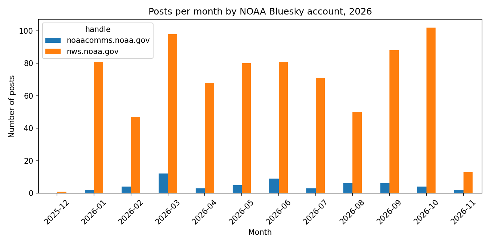
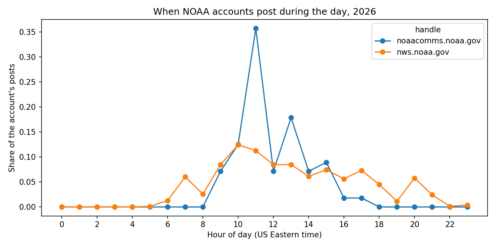

# How Do NOAA's Bluesky Accounts Differ in What and When They Post?

**Author:** Luke Carrano

## Summary

NOAA runs several verified accounts on Bluesky under its own .gov domain: the National Weather Service, NOAA Climate, and NOAA Communications. This project asks how these accounts differ in how often they post, which days and hours they post, and how much they rely on images and video, and whether those differences line up with how many reposts their posts get. I collect the public posts from the Bluesky API and compare the accounts.

## Data

**Source:** Bluesky's public API (`https://public.api.bsky.app/xrpc/`), using `getProfiles` and `getAuthorFeed`. It needs no account or key. The three accounts are `nws.noaa.gov`, `climate.noaa.gov` and `noaacomms.noaa.gov`. NOAA's main account is left out because its `noaa.gov` handle did not resolve when I collected (Bluesky's API returned an error for it). Each handle is a .gov domain and each account is verified by Bluesky, which is how I know they belong to NOAA.

**When collected:** [2026-11-09, copy from `local_data/raw/collected_at.txt`]. The collection covers posts from 2026-01-01 up to that date.

**How many records:** [836] posts in the cleaned data across the three accounts ([nws.noaa.gov 780, noaacomms.noaa.gov 56, climate.noaa.gov 0] per account, see the output of `clean_data.py`). Before cleaning there were [954] items in the raw feeds.

**What is in the repo:** the collection and cleaning code (`collect_data.py` and `clean_data.py`), a 30-row sample of the cleaned data (`data/sample_posts_clean.csv`), and a data dictionary (`data_dictionary.md`).

**What is left out and why:**
- `local_data/raw/` (the raw JSON from the API). It is large, it includes reposts of other people's posts which could be private people, and the API terms and the platform's data can change, so it is better to rerun the collection than to republish it.
- `local_data/clean/posts_clean.csv` (the full cleaned table). It is only public agency posts, but I kept it out so the repo stays small and everything can be rebuilt from the code. The sample shows the format.
- No private people's posts are in the cleaned data. Reposts and replies are filtered out.

**Politeness:** every request sends a User-Agent with my contact email and the script waits 1 second between requests.

## Methods

Between January 1 and November 8, 2026, noaacomms.noaa.gov posted 56 times, nws.noaa.gov posted 780 times. climate.noaa.gov had no posts in this period, so the comparison is between the accounts above.

- **noaacomms.noaa.gov**: most posts on Thursdays, busiest hour 11:00 Eastern, 14% of posts have an image or video, median 2 reposts and 7 likes per post.
- **nws.noaa.gov**: most posts on Fridays, busiest hour 10:00 Eastern, 96% of posts have an image or video, median 20 reposts and 82 likes per post.

These results are descriptive and preliminary. Counts of likes and reposts are a snapshot from the collection date, and the data cannot show why one account posts differently from another.



*Figure 1. Number of posts per month for each NOAA account that posted in 2026.*



*Figure 2. Share of each account's posts made in each hour of the day, in US Eastern time.*

## Findings

*To be filled in.*

## How to reproduce

```
pip install requests pandas matplotlib
python collect_data.py
python clean_data.py
```

Edit the email in `HEADERS` in `collect_data.py` first. Collection saves raw JSON to `local_data/raw/`, and cleaning writes `local_data/clean/posts_clean.csv` and `data/sample_posts_clean.csv`. Your counts will differ from mine because the accounts keep posting.
